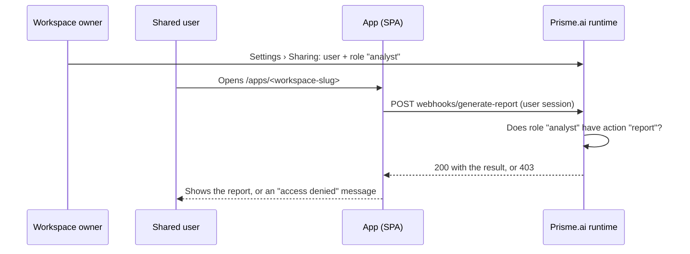

Your workspace serves a React app (SPA) at `/apps/<workspace-slug>`. This guide shows how to decide **who can use it** and **what each person can do in it**, using the roles of the workspace. Once it is set up, giving someone access takes one step in **Settings › Sharing**: pick the person, pick a role.

No access-management screen to build, no allowlist to maintain: the platform enforces the roles on every call.

## How it works

The app's access decides who can load its JavaScript bundle: the workspace collaborators and the organizations or groups it is shared with for a **Private** app, any signed-in user for a **Signed-in users** app (see [Publish pages](/products/ai-builder/deployment#publish-pages)). Loading the interface gives no access to data: **what protects your data is the set of automations the app calls.** Each endpoint carries an action name, and the workspace security rules decide which role may execute which action.



<Info>
  Page-level sharing (public switch, per-page users) applies to block pages, not to a SPA. For an app, share the **workspace** with a role, as described below.
</Info>

## Set it up

<Steps>
  <Step title="Declare the roles and their actions">
    Open **Settings › Security**. Add your roles under `roles`, then one rule per role listing the **actions** it may execute. An action is a name you choose; it links roles to endpoints.

    In this example, `app` means "can open the app" and `report` means "can generate a report".

    ```yaml
    authorizations:
      roles:
        editor: {}
        reader: {}
        analyst: {}
      rules:
        # ...keep the existing rules (editor, events, files...)
        - role: reader
          action: execute
          subject: automations
          conditions:
            authorizations.action:
              $in:
                - app
          reason: A reader opens the app
        - role: analyst
          action: execute
          subject: automations
          conditions:
            authorizations.action:
              $in:
                - app
                - report
          reason: An analyst opens the app and generates reports
    ```

    The workspace owner and editors can execute every automation; you don't need to list them.
  </Step>

  <Step title="Protect every endpoint the app calls">
    Add an `authorizations` block to each automation exposed as an endpoint. The runtime rejects the call with **403** before running the automation when the caller's role lacks the action.

    ```yaml
    slug: generate-report
    name: Report/Generate
    when:
      endpoint: true
    authorizations:
      action: report
    do:
      - set:
          name: result
          value:
            generated_at: '{{run.date}}'
            by: '{{user.id}}'
    output: '{{result}}'
    ```

    <Warning>
      **By default, an endpoint without `authorizations.action` can be executed by anyone, even without signing in.** Restrict them all at once in **Settings › Security › Access control**, with the same audience as the app: **Signed-in users**, or **Private** with the organizations and groups of the app (see [Control who calls the endpoints and emits events](/products/ai-builder/rbac#control-who-calls-the-endpoints-and-emits-events)). The **Publish** dialog warns while they are open to anyone. An endpoint that must stay public on purpose takes `authorizations.action: public`.
    </Warning>
  </Step>

  <Step title="Add a `me` endpoint to adapt the interface">
    The app needs to know what to display: which tabs, which buttons. A small endpoint returns the caller's role on the workspace. The runtime provides it directly in `{{user.role}}`, with no API call.

    It is protected by the `app` action, so a signed-in person you have not shared the workspace with gets a 403, and the app can show a clear message.

    ```yaml
    slug: me
    name: Access/My role
    description: Caller's role on the workspace, used by the app to adapt its interface.
    when:
      endpoint: true
    authorizations:
      action: app
    do:
      - set:
          name: result
          value:
            id: '{{user.id}}'
            role: '{{user.role}}'
    output: '{{result}}'
    ```

    | Caller | `me` returns |
    | --- | --- |
    | Workspace owner or editor | `owner` or `editor` (every action allowed) |
    | Shared with a custom role | that role, for example `reader` or `analyst` |
    | Signed in, not shared | **403** |
  </Step>

  <Step title="Adapt the app">
    Two rules on the React side: call the endpoints **with the user's session** (the `sdk` prop carries it), and treat 401/403 as a normal state of the interface.

    <CodeGroup>
    ```ts src/api.ts
    import type { SDK } from '@/types'

    export class AccessDenied extends Error {
      constructor(public status: number) { super(`HTTP ${status}`) }
    }

    // Calls a workspace endpoint with the signed-in user's session.
    export async function callEndpoint<T>(sdk: SDK, workspace: string, endpoint: string, body = {}): Promise<T> {
      const headers: Record<string, string> = { 'Content-Type': 'application/json' }
      if (sdk.token) headers['Authorization'] = `Bearer ${sdk.token}`
      if (sdk._csrfToken) headers['x-prismeai-csrf-token'] = sdk._csrfToken

      const res = await fetch(`${sdk.host}/workspaces/slug:${workspace}/webhooks/${endpoint}`, {
        method: 'POST',
        headers,
        credentials: 'include',
        body: JSON.stringify(body),
      })
      if (res.status === 401 || res.status === 403) throw new AccessDenied(res.status)
      if (!res.ok) throw new Error(`HTTP ${res.status}`)
      return res.json()
    }
    ```

    ```tsx src/App.tsx
    import { useEffect, useState } from 'react'
    import { callEndpoint, AccessDenied } from '@/api'
    import type { AppProps } from '@/types'

    // What each role sees. Display only: the endpoints remain the real check.
    const VIEWS: Record<string, string[]> = {
      owner: ['home', 'report'],
      editor: ['home', 'report'],
      analyst: ['home', 'report'],
      reader: ['home'],
    }

    export default function App({ sdk, workspace }: AppProps) {
      const [role, setRole] = useState<string | null>(null)
      const [denied, setDenied] = useState(false)

      useEffect(() => {
        callEndpoint<{ role: string }>(sdk, workspace.slug, 'me')
          .then((me) => setRole(me.role))
          .catch((e) => setDenied(e instanceof AccessDenied))
      }, [sdk, workspace.slug])

      if (denied) return <p>You don't have access to this app. Ask its administrator.</p>
      if (!role) return <p>Loading…</p>

      const views = VIEWS[role] ?? []
      return (
        <Tabs views={views}>
          {views.includes('report') && (
            <ReportButton onClick={() => callEndpoint(sdk, workspace.slug, 'generate-report')} />
          )}
        </Tabs>
      )
    }
    ```
    </CodeGroup>

    `Tabs` and `ReportButton` stand for your own components. Keep the 403 handling on every call: a role can change while the app is open.
  </Step>

  <Step title="Deploy and share">
    Publish the app from the **Publish** button of the page editor (see [Publish pages](/products/ai-builder/deployment#publish-pages)) with the **Private** access, shared with the organizations or groups of its users, or with the **Signed-in users** access, so the platform asks users to sign in before loading it.

    Then open **Settings › Sharing**:

    - **Add members**: select the people, pick their role (`reader`, `analyst`…), confirm.
    - **Change a role**: use the role dropdown on the member's row.
    - **Remove access**: click the trash icon on the member's row.

    <Frame>
      
    </Frame>

    Changes apply **immediately** to the endpoints. Send the app link (`/apps/<workspace-slug>`) to the people you added.

    <Warning>
      The role list also offers `owner`, `editor` and `viewer`. These roles open the workspace itself in the Builder (`viewer` in read-only mode). Keep them for the people who build the app, and give app users your custom roles.
    </Warning>
  </Step>
</Steps>

## Check the result

Test with at least two accounts besides yours: one per role, plus one signed-in account the workspace is not shared with.

| Account | Opens the app | Sees the Report tab | Generates a report |
| --- | --- | --- | --- |
| `reader` | Yes | No | No (403) |
| `analyst` | Yes | Yes | Yes (200) |
| Signed in, not shared | "Access denied" message | No | No (403) |
| Not signed in | Sign-in page | No | No (403) |

The test that matters: with the `reader` account, call the endpoint directly, outside the interface. It must answer 403, which proves that protection does not depend on what the app hides.

```bash
curl -X POST "https://<api-host>/v2/workspaces/slug:<workspace-slug>/webhooks/generate-report" \
  -H "Authorization: Bearer <reader account token>" \
  -H "Content-Type: application/json" -d '{}'
# expected: HTTP 403
```

## Good to know

<AccordionGroup>
  <Accordion title="People must already have an account">
    You can only share with someone who has signed in to the platform at least once. Otherwise the Builder reports that the user could not be found.
  </Accordion>
  <Accordion title="Shared users don't get Builder access">
    A person shared with a custom role does not see the workspace in the Builder and cannot edit it. They only reach what the endpoints allow.
  </Accordion>
  <Accordion title="Nothing secret in the bundle">
    The app's JavaScript file is served publicly. Never put keys or data in it: everything goes through the endpoints.
  </Accordion>
  <Accordion title="Public apps">
    A public app renders without sign-in, so visitors have no role and every protected endpoint refuses them. Public mode suits open experiences, not role-based ones. See [Authentication & redirect](/products/ai-builder/authentication-redirect).
  </Accordion>
  <Accordion title="Prefer endpoints for sensitive operations">
    This guide protects endpoints (HTTP calls). Route every sensitive operation through an endpoint protected by `authorizations.action`.
  </Accordion>
</AccordionGroup>

## Checklist

- Roles and their actions are declared in **Settings › Security**.
- Every endpoint the app calls carries `authorizations.action`.
- The endpoints and events are not public in **Settings › Security › Access control**.
- The `me` endpoint returns the role and is protected by the `app` action.
- The app calls endpoints with the user's session and shows a clear message on 401/403.
- The app is deployed **not public**.
- App users are added in **Settings › Sharing** with a custom role, never `owner`, `editor` or `viewer`.
- A direct call to a protected endpoint with a `reader` account returns 403.

## Next Steps

<CardGroup cols={2}>
  <Card title="Role-Based Access Control" icon="shield" href="/products/ai-builder/rbac">
    The full RBAC grammar: roles, rules, subjects and conditions
  </Card>
  <Card title="Pages" icon="browser" href="/products/ai-builder/pages">
    Build the React app and connect it to automations
  </Card>
</CardGroup>
