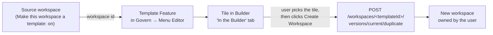

A **workspace template** is a workspace that appears as a tile when a user creates a new workspace in [Builder](/products/ai-builder/overview). Picking it duplicates the source workspace (automations, imports, pages, configuration, security rules) into a fresh workspace owned by the user.

Publishing a template takes two independent steps, owned by two different roles:

1. **In Builder**, the owner of the source workspace marks it as a template. This is what makes it *duplicable* by other users.
2. **In AI Governance**, an organization admin adds a **Template Feature** in the **Menu Editor**. This is what makes it *discoverable*, as a tile in Builder's creation flow.

Use templates to:

- Standardize a starting point for new use cases (e.g. "Custom RAG", "Webhook gateway", "OAuth-enabled connector")
- Share a polished demo with colleagues without giving them write access to your workspace
- Bootstrap reference architectures your team can fork and adapt

## How templating works



The Builder reads the organization's navigation and turns every Template Feature it finds into a tile. When the user confirms the creation wizard, the Builder calls `POST /workspaces/<templateId>/versions/current/duplicate`, then renames the copy with the name and description entered in the wizard.

## Step 1: Prepare and mark the source workspace

Before publishing, treat your source as a product:

- **Make it work out of the box**: the copy should run without manual fixup, apart from the secrets the user has to provide (see [Configuration and secrets](#configuration-and-secrets)).
- **No personal data**: clear out test users, real tokens and hard-coded customer ids. Configuration values are copied as-is, so anything that would embarrass you in someone else's workspace shouldn't be in the template.
- **Document it**: a README page or an automation description goes a long way, since the tile itself only shows a label.

Then open the workspace in Builder, go to **Settings**, and turn on **Make this workspace a template** (section **Public Template**).


The toggle provisions two things together:

| What | Purpose |
|---|---|
| The reserved `template` label | Marks the workspace as a template. AI Governance checks it before accepting a Template Feature that points to this workspace. |
| Two open-read security rules (`read` on `workspaces` and `pages`, reason `template:REMOVE_ON_DUPLICATE`) | Let **any signed-in user** read the workspace and its pages, which is what allows someone who isn't a collaborator to duplicate it. |

It's **the security rules, not the label**, that authorize duplication. Without them, the duplicate call is denied for anyone but the workspace's own collaborators.

<Warning>
A template is readable by every signed-in user of the platform, not only by the people who can see its tile. Hiding the tile (see [Visibility](#visibility)) does not prevent someone who knows the workspace id from duplicating it through the API. Never put confidential logic or data in a template.
</Warning>

Turning the toggle off removes both the label and the rules: new duplications stop immediately, existing copies and the source content are untouched.

Note the **workspace id** (visible in the Builder URL, e.g. `/builder/kFoNvfX`): you'll need it in step 2.

## Step 2: Declare a Template Feature in AI Governance

Template Features live in the organization's navigation, managed from the **Menu Editor**.

1. Open **Govern** (AI Governance) from the sidebar.
2. Go to **Menu Editor**.
3. Edit (or create) the menu item the template should be attached to, typically the **Builder** entry. The tile is shown to every user who can see that item (see [Visibility](#visibility)).
4. Click **Add Feature → Template Feature**.
5. Fill in the fields:

| Field | Description |
|---|---|
| **Template ID** | The **workspace id** of the source workspace from step 1. |
| **Label** | The name shown on the tile in Builder. Localized: switch the editing language to provide one label per language. |
| **Permissions** | Stored with the feature, but **not applied to template tiles** today. Restrict the parent menu item instead. |

The feature's internal slug is generated from the label (with a numeric suffix if another feature already uses it), so there is no Slug field to fill.

6. **Save**. Every Template ID is checked against the backend before the navigation is saved:
   - if the workspace doesn't exist, or you can't read it, the editor shows *"This workspace doesn't exist or you don't have access to it."*;
   - if it exists but isn't marked as a template, the editor shows *"This workspace exists but isn't declared as a template yet. Enable it from the workspace's Settings first."*

   This prevents publishing a tile that would fail for every other user.


<Tip>
The tile appears in Builder as soon as the navigation is saved, with no rebuild or cache flush.
</Tip>

If you edit the navigation through the API, a Template Feature looks like this (the `slug` is required here and must be unique across the whole menu):

```yaml
menu:
  - id: builder
    type: item
    label:
      en: Builder
      fr: Builder
    icon: hammer
    href: /builder
    features:
      - type: template
        slug: custom-rag-template
        templateId: kFoNvfX
        label:
          en: Custom RAG
          fr: RAG personnalisé
```

## Step 3: Verify the template

Test with a user who is **not** a collaborator of the source workspace, otherwise a missing security rule would go unnoticed.

1. In Builder, click **Create new workspace**.
2. In the **What do you want to build?** dialog, open the **In the Builder** tab. Your template appears as a tile between **From Scratch** and **Import ZIP**, with your label and the generic description *Create from template*.
3. Pick the tile. The **Create Workspace** wizard opens with your template preselected on the **Type** step; click **Next**. The **Details** step is prefilled with the template label as name.
4. Adjust the name and description, then click **Create Workspace**. The duplication runs at this point (*Preparing workspace...*), and you land in the new workspace.
5. Check that the expected automations, imports, pages and configuration are there, and fill in the secrets.


If the creation fails with *Failed to create workspace from template*, the most common cause is that the source is no longer marked as a template (toggle turned off, or security rules edited by hand).

## What the copy contains

| Copied from the source | Reset or left out |
|---|---|
| Automations, imports (app instances and their configuration), pages | Name and description: replaced by what the user entered in the wizard |
| Workspace configuration (`config`, including its values), photo, repositories | Slug: a new random slug is generated |
| Security roles and rules, **except** the template rules (`REMOVE_ON_DUPLICATE`), so the copy isn't itself open to everyone | Members: the user who created the copy is its only owner |
| Labels, except `template`, `suggestions` and `production:*` | Secret values, files (uploads), collection data, events, custom domains, version history |

The copy also receives a `fromTemplate:<sourceWorkspaceId>` label, a queryable trace of its origin that isn't shown in the UI. A copy is never a template itself.

### Configuration and secrets

The creation wizard only asks for a name and a description: it does **not** render a configuration form. Anything the user needs to customize happens in the new workspace after creation:

- **Configuration**: values declared in the source `config` are copied as-is and resolve as `{{config.<field>}}` in the copy. Ship sensible defaults, and tell users which ones to change.
- **Secrets**: values are never copied. Secrets declared in the source's configuration schema show up in the copy under **Settings → Secrets → Configuration Secrets**, empty, ready to be filled in.

## Visibility

Template tiles follow the visibility of the menu item that carries them:

- if the user can see the parent menu item, they see all its Template Features;
- to limit a template to some users, set **Permissions** on the parent menu item (for example on a dedicated item). See [Permission-Based Visibility](/products/ai-governance/platform-customization#permission-based-visibility).

The **Permissions** field of the Template Feature itself is not taken into account for template tiles.

Visibility only controls the tile. Who can actually *duplicate* the template is decided by the source workspace's security rules (step 1).

## Maintaining a template

A template is just a workspace, so:

- **Update it** like any other workspace. Existing copies are never modified: the link between a copy and its template is one-shot.
- **Iterate on a separate workspace.** The Builder always duplicates the source's `current` state, not a published version, so every save on the source is visible to the next user who clones it.
- **Retire a template** by removing its Template Feature from the Menu Editor (the tile disappears) and turning off **Make this workspace a template** (duplication stops, including through the API). The source workspace stays intact.

## Templates vs publishing as an app

Don't confuse a **template** with **publishing a workspace as a platform app**:

| | Workspace template | Published app |
|---|---|---|
| **Purpose** | Starting point users clone and modify | Live application users open and use |
| **Where it's declared** | Builder Settings toggle + Govern → Menu Editor → Template Feature | "Add to Platform" modal (bundles + route) |
| **What the user gets** | A new workspace in their account | A new entry in the platform navigation |
| **Where users find it** | Create new workspace → In the Builder | Sidebar / app launcher |

You can do both: a template that users clone for customization *and* a published app that users open as-is.

## Related

<CardGroup cols="2">
  <Card title="Workspaces" icon="briefcase" href="/products/ai-builder/workspaces#project-templates">
    The template flow from the Builder side: creating a workspace from a template.
  </Card>
  <Card title="Menu Editor" icon="bars" href="./platform-customization#menu-editor">
    Where Template Features live, plus the wider menu/navigation model.
  </Card>
  <Card title="Versioning" icon="code-branch" href="/products/ai-builder/versioning">
    Export, import and repository sync for the source workspace.
  </Card>
  <Card title="Identity & Access" icon="user-shield" href="./identity-access">
    Permissions model used by the Menu Editor's visibility filters.
  </Card>
</CardGroup>
