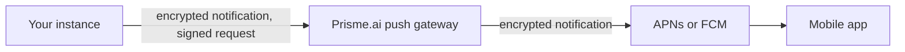

Follow this guide to let users of the Prisme.ai mobile app receive notifications from your self-hosted instance. Until these steps are complete, the instance sends nothing and the mobile apps cannot register a device.

## Before you begin

- **Who:** a platform administrator with access to the `agent-factory` workspace of the instance.
- **Requires:** direct outbound HTTPS from the instance to the push gateway. See [Known limit behind an egress proxy](#known-limit-behind-an-egress-proxy).
- **Requires:** the Prisme.ai team, who registers your instance's public key at the gateway.
- **Impact:** changing the instance key later invalidates registered devices. They register again the next time the app starts.

{/* REVIEW: confirm the channel used to request an instance registration. */}

## How it works



The instance encrypts each notification with a key created by the user's phone (RFC 8291), with a fixed size. It then signs the request with its own Ed25519 key. The gateway authenticates the instance, applies quotas, and forwards the encrypted data. It cannot read the content.

Device tokens and notification keys are sealed in the instance's database with a key derived from the instance's private key.

## Set up the instance

<Steps>
  <Step title="Generate the instance key">
    Generate an Ed25519 key, then print the private key (PKCS#8 DER) and the public key (SPKI DER), both in base64url:

    ```bash
    openssl genpkey -algorithm ed25519 -outform DER -out push-instance.der
    openssl base64 -A -in push-instance.der | tr '+/' '-_' | tr -d '='
    openssl pkey -inform DER -in push-instance.der -pubout -outform DER | openssl base64 -A | tr '+/' '-_' | tr -d '='
    ```

    Keep the private key in your secret manager and delete the local file once the setup is complete.
  </Step>
  <Step title="Register the instance">
    Send the Prisme.ai team the public key and a label for the instance. Never send the private key. You receive an instance identifier.
  </Step>
  <Step title="Update the workspace configuration">
    Instances installed before this feature have no `push` block in the `agent-factory` configuration, because a release does not overwrite an existing configuration. Add it, using the gateway URL given by the Prisme.ai team:

    ```yaml
    push:
      gateway_url: <push gateway URL>
      instance_id: '{{secret.push_instance_id}}'
      private_key: '{{secret.push_instance_private_key}}'
      max_devices_per_user: 10
    ```

    `max_devices_per_user` is the number of devices kept for each user. When a user goes over it, their oldest devices are removed.
  </Step>
  <Step title="Set the secrets">
    In the secrets of the `agent-factory` workspace, set these values:

    | Secret | Value |
    |---|---|
    | `push_instance_id` | The instance identifier you received. |
    | `push_instance_private_key` | The base64url private key from the first step. |
  </Step>
</Steps>

## Verify

1. Sign in to the mobile app on the instance and allow notifications.
2. Send a message to an agent, then leave the app before the reply ends.
3. Check that the notification appears on the phone.

## Troubleshooting

| Symptom | Cause | Resolution |
|---|---|---|
| `POST /v1/push/devices` answers `503` with `PUSH_NOT_CONFIGURED` | The `push` block or a secret is missing, or the private key is too short to be valid. | Complete [Set up the instance](#set-up-the-instance). |
| An `error` event `PushDeliveryFailed` with the code `GatewayUnreachable` | The instance cannot reach the gateway. | Open outbound HTTPS to the gateway. |
| An `error` event `PushDeliveryFailed` with the HTTP status `401` | The gateway does not recognize the instance or its key. | Check the instance identifier and the key with the Prisme.ai team. |
| An `error` event `PushDeliveryFailed` with the HTTP status `429` | The instance went over its quota per minute. | Failed notifications are not sent again. Contact the Prisme.ai team if this recurs. |

{/* REVIEW: confirm the exact `status` and `http_status` values reported for 401 and 429. */}

## Known limit behind an egress proxy

Delivery opens a direct HTTPS connection that does not follow `HTTPS_PROXY`. Behind a mandatory egress proxy, every send fails with `GatewayUnreachable`. Allow a direct route from the instance to the gateway host.

## Next steps

- [What users see in the mobile app](/products/ai-securechat/mobile-notifications)
- [Manage encryption keys](/self-hosting/operations/encryption-keys)
